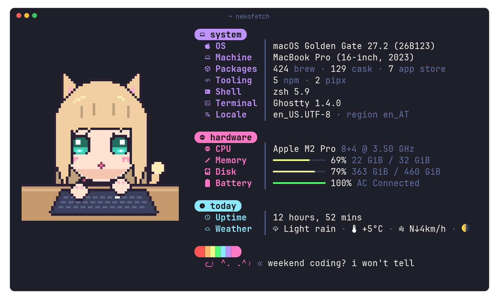

<div align="center">



# nekofetch

**fastfetch, but with catgirls.**

[](https://github.com/ArchitektApx/nekofetch/actions)
[](https://github.com/ArchitektApx/nekofetch/blob/main/LICENSE)
[](https://www.python.org)
[](#terminals)
[](#byoc---bring-your-own-cats)

</div>

A [fastfetch](https://github.com/fastfetch-cli/fastfetch) setup that greets every new shell with a cat, drawn as nicely as your terminal allows. She also knows the weather and counts your packages. And she has opinions: about your battery, your uncommitted changes, and the fact that it's 3 am.

<p align="center"><b>Why?</b><br>Because catgirls are cute ok?</p>

## Install

```sh
uv tool install git+https://github.com/ArchitektApx/nekofetch    # or: pipx install git+...
nekofetch setup
```

`setup` creates `~/.config/nekofetch` and asks before adding one line to your zsh, bash or fish config. You'll need [fastfetch](https://github.com/fastfetch-cli/fastfetch#installation) 2.40 or newer, Python 3.11+ and a [Nerd Font](https://www.nerdfonts.com). For animated cats in kitty and Ghostty, also install `kitten` (it comes with kitty). [chafa](https://hpjansson.org/chafa/) is optional, for your own images in terminals without image support.

## Terminals

nekofetch works out where it's running and picks the best way to draw. If something looks off, `nekofetch doctor` shows what it found.

| Terminal | Drawn with | Animated |
| :-- | :-- | :-: |
| kitty, Ghostty | kitty graphics via `kitten icat` | ✓ |
| kitty, Ghostty without `kitten` | kitty graphics, PNG only | |
| iTerm2, WezTerm | iTerm inline images | ✓ |
| foot, Konsole, Windows Terminal | sixel via chafa | |
| everything else, SSH too | pixel-exact block art (your own images: chafa) | |
| nothing else works | the braille cat | she tries |

Ghostty animates from version 1.4. In tmux, kitty and Ghostty keep their images if you `set -g allow-passthrough on`.

## Configure

`~/.config/nekofetch/config.toml` (all optional):

```toml
[image]
order = "random"         # or "sorted"
protocol = "auto"        # kitty, kitty-direct, iterm, sixel, blocks, chafa, ascii, none
defaults = "fallback"    # bundled cats: "fallback", "always" or "never"

[weather]
location = ""            # empty: wttr.in guesses. or "Vienna", "VIE", "~Eiffel Tower"
units = "metric"

[says]
uwu = "april"            # true, false, or "april": only on April 1st
```

- **Weather** comes from [wttr.in](https://wttr.in). It's cached and refreshed in the background, so it never slows your prompt down. For weather that's fresh at every shell start, `nekofetch setup --weather-timer` adds a small launchd or systemd timer; `setup --undo` removes it.
- **The cat's lines** live in [`says.toml`](https://github.com/ArchitektApx/nekofetch/blob/main/src/nekofetch/data/says.toml), with lines for rain, Monday mornings, low battery, a dirty git tree and more. Copy it to `~/.config/nekofetch/` to write your own, then check it with `nekofetch says --check`.
- **The layout** is a regular fastfetch config, [`layout.jsonc`](https://github.com/ArchitektApx/nekofetch/blob/main/src/nekofetch/data/layout.jsonc), and can be overridden the same way.

`nekofetch --help` lists everything else.

## BYOC - Bring your own cats

The bundled cats are original pixel art. They hold the spot until you bring your own:


```sh
nekofetch add ~/Pictures/neko.gif     # files or URLs; GIF, PNG, JPG, WebP
nekofetch fetch 5                     # 5 random nekos from nekos.best
```

They go into `~/.config/nekofetch/images`. Put a `.png` next to a `.gif` with the same name, and terminals that can't do GIFs use the PNG. Fetched images belong to their artists, who are listed in `CREDITS.txt`.

## FAQ

**Boxes instead of icons?**<br>
Your terminal needs a [Nerd Font](https://www.nerdfonts.com).

**Wrong city in the weather?**<br>
wttr.in guesses from your IP. Set `location`.

**Only the braille cat shows up.**<br>
Run `nekofetch doctor`. Usually it's one of your own images in a terminal without image support, and `chafa` isn't installed.

**uwu?**<br>
`nekofetch --uwu`. Or wait for April.

## Hacking

```sh
uv run nekofetch                          # run from the checkout
uv run pytest                             # tests
uv run ruff check && uv run pyright       # lint (ruff ALL) and types (pyright strict)
```

A new terminal is one entry in [`terminals.py`](https://github.com/ArchitektApx/nekofetch/blob/main/src/nekofetch/terminals.py), a new way to draw is one `@renderer` class in [`renderers.py`](https://github.com/ArchitektApx/nekofetch/blob/main/src/nekofetch/renderers.py), and a new package manager is one function in [`packages.py`](https://github.com/ArchitektApx/nekofetch/blob/main/src/nekofetch/sources/packages.py). The bundled art is drawn by [`tools/draw.py`](https://github.com/ArchitektApx/nekofetch/blob/main/tools/draw.py) if you want to make more cats.

## Uninstall

```sh
nekofetch setup --undo && uv tool uninstall nekofetch
```

## License

The code is [MIT](https://github.com/ArchitektApx/nekofetch/blob/main/LICENSE). The bundled pixel art is [CC0](https://github.com/ArchitektApx/nekofetch/blob/main/src/nekofetch/data/images/LICENSE), so do what you like with it.

<div align="center"><br><sub>ᓚ₍ ^. .^₎ made by <a href="https://github.com/ArchitektApx">ArchitektApx</a></sub></div>
